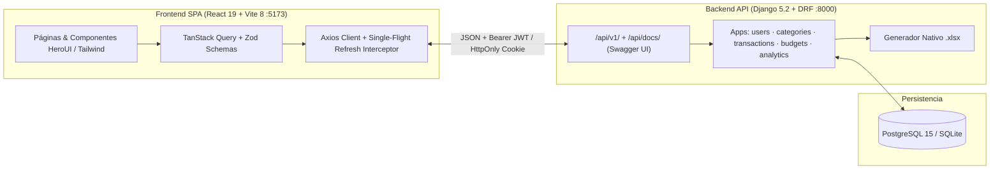

# PESHITO — Tracker de Finanzas Personales (v1.0.0)


**PESHITO** es una aplicación web full-stack para gestionar finanzas personales con claridad: registra ingresos y gastos en segundos, controla presupuestos mensuales por categoría con alertas visuales, analiza la distribución del gasto en tiempo real y permite descargar reportes en **Excel (`.xlsx`)** y **PDF (`.pdf`)**.

---

## Características Principales

- **Dashboard Financiero en Tiempo Real:** KPIs mensuales (Balance Neto, Ingresos, Gastos y Tasa de Ahorro), navegación temporal mes/año, gráfico de dona interactivo con centro reactivo al hover y progreso de presupuestos.
- **Gestión de Movimientos (CRUD + Edición In-Place):** Creación y edición desde el mismo modal con validación tipada en **Zod**, filtros combinados (búsqueda, categoría, tipo y orden), tabla en escritorio y tarjetas tipo app nativa en móvil (`< 768px`).
- **Presupuestos Inteligentes:** Techos mensuales por categoría con semáforo de consumo (`< 80%` saludable, `80-100%` alerta, `> 100%` excedido) y acordeón desplegable con los últimos gastos de cada categoría.
- **Portabilidad Real de Datos (Cero Dependencias Externas):**
  - **Planilla Excel (`.xlsx`):** Exportación directa de movimientos filtrados desde el backend (`/api/v1/transactions/export/`).
  - **Reporte Mensual PDF (`.pdf`):** Resumen ejecutivo A4 generado al instante desde el Dashboard.
- **Seguridad y Aislamiento Multi-Tenant:** Autenticación JWT con *access token* de vida corta, *refresh token* rotativo en cookie `HttpOnly` con lista negra, throttling contra fuerza bruta y aislamiento estricto por `request.user`.
- **Identidad Visual & Mobile-First:** Paleta *Ivory & Midnight Violet* con soporte nativo para modo claro/oscuro, estados vacíos ilustrados con la mascota **Peshi** y carga diferida de rutas (`React.lazy` + `Suspense`).

---

## Stack Tecnológico

| Capa | Tecnologías |
|---|---|
| **Backend** | Python 3.12+, Django 5.2, Django REST Framework, SimpleJWT (HttpOnly Refresh Cookie), django-filter, drf-spectacular (OpenAPI 3.0) |
| **Frontend** | React 19, Vite 8, Tailwind CSS 3.4, HeroUI, TanStack Query v5, React Router v7, Recharts, Zod, Axios, Lucide React |
| **Base de Datos** | PostgreSQL 15 (Docker / Producción) · SQLite 3 (Fallback automático para desarrollo local) |
| **Calidad & DevOps** | 173 tests automatizados (Django `APITestCase`), Oxlint, GitHub Actions CI, Docker & Docker Compose |

---

## Arquitectura del Sistema



### Estructura del Monorepo

```text
tracker-finanzas-mvp/
├── backend/
│   ├── config/
│   │   ├── settings/             # base.py · local.py · production.py
│   │   ├── pagination.py
│   │   └── urls.py               # /api/v1/, /api/schema/, /api/docs/, /api/redoc/
│   ├── apps/
│   │   ├── users/                # Custom User (email login) + Auth JWT cookies
│   │   ├── categories/           # Categorías híbridas + comandos seed_categories y seed_peshito
│   │   ├── transactions/         # CRUD movimientos + filtros + exportador Excel (.xlsx)
│   │   ├── budgets/              # Presupuestos mensuales por categoría y cálculo de consumo
│   │   └── analytics/            # Resumen mensual, desglose por categoría y tendencia
│   ├── Dockerfile
│   └── requirements.txt
├── frontend/
│   ├── src/
│   │   ├── api/                  # Instancia Axios con cola de refresco y servicios REST
│   │   ├── components/           # Subcomponentes modulares (home, dashboard, budgets, transactions, common)
│   │   ├── context/              # AuthContext y ThemeContext (claro/oscuro)
│   │   ├── layouts/              # AppLayout (barra superior + bottom nav móvil con safe-area)
│   │   ├── pages/                # HomePage · Login · Register · Dashboard · TransactionsPage · BudgetsPage
│   │   ├── routes/               # AppRoutes con React.lazy + Suspense, ProtectedRoute y PublicRoute
│   │   ├── schemas/              # Validación Zod centralizada (auth, transaction, budget)
│   │   └── utils/                # Formateadores (ARS / fechas / %) y generador PDF A4 (exportPdf.js)
│   ├── Dockerfile
│   └── package.json
├── .github/workflows/ci.yml
├── docker-compose.yml
└── README.md
```

---

## Despliegue Rápido con Docker (1 Comando)

Levanta la base de datos **PostgreSQL 15**, el **Backend Django** (ejecutando migraciones y el seed demo automáticamente) y el **Frontend React**:

```bash
docker-compose up --build
```

Una vez iniciado el entorno:

| Servicio | URL | Descripción |
|---|---|---|
| **Aplicación Web (Frontend)** | [http://localhost:5173](http://localhost:5173) | Landing Page, Login y Panel Financiero |
| **Swagger UI (OpenAPI 3.0)** | [http://localhost:8000/api/docs/](http://localhost:8000/api/docs/) | Explorador interactivo de la API con autorización JWT |
| **Redoc** | [http://localhost:8000/api/redoc/](http://localhost:8000/api/redoc/) | Documentación de referencia de la API |
| **Admin de Django** | [http://localhost:8000/admin/](http://localhost:8000/admin/) | Panel administrativo de modelos |

### Credenciales del Usuario Demo (Pre-cargado por `seed_peshito`)

- **Correo:** `demo@peshito.app`
- **Contraseña:** `PeshitoDemo2026!`

*(Incluye 11 categorías globales, 18 movimientos distribuidos entre el mes actual y el anterior, y 4 presupuestos activos listos para probar gráficos, edición in-place y descargas en Excel/PDF).*

---

## Especificación de Endpoints Principales (`/api/v1/`)

| Método | Endpoint | Descripción | Autenticación |
|---|---|---|---|
| `POST` | `/api/v1/auth/register/` | Registro de nuevo usuario | Pública |
| `POST` | `/api/v1/auth/token/` | Login (devuelve `access` y setea cookie `refresh_token`) | Pública |
| `POST` | `/api/v1/auth/token/refresh/` | Rotación de token desde cookie `HttpOnly` | Cookie |
| `POST` | `/api/v1/auth/logout/` | Cierre de sesión y revocación en blacklist | Bearer JWT |
| `GET / PATCH` | `/api/v1/auth/me/` | Perfil y moneda preferida del usuario autenticado | Bearer JWT |
| `GET / POST` | `/api/v1/categories/` | Listado de categorías (globales + propias) y creación | Bearer JWT |
| `GET / POST` | `/api/v1/transactions/` | Listado paginado/filtrado y creación de movimientos | Bearer JWT |
| `PATCH / DELETE` | `/api/v1/transactions/{id}/` | Edición in-place o eliminación de un movimiento | Bearer JWT |
| `GET` | `/api/v1/transactions/export/` | Descarga de movimientos filtrados en Excel (`.xlsx`) | Bearer JWT |
| `GET / POST` | `/api/v1/budgets/` | Listado por `month`/`year` y creación de presupuestos | Bearer JWT |
| `PATCH / DELETE` | `/api/v1/budgets/{id}/` | Edición in-place o eliminación de un presupuesto | Bearer JWT |
| `GET` | `/api/v1/analytics/summary/` | Balance neto, ingresos, gastos y tasa de ahorro | Bearer JWT |
| `GET` | `/api/v1/analytics/category-breakdown/` | Distribución porcentual de gastos por categoría | Bearer JWT |

---

## Desarrollo Local (Sin Docker)

El backend detecta automáticamente la ausencia de `POSTGRES_HOST` / `DATABASE_URL` y utiliza **SQLite** sin configuración adicional:

```bash
# 1. Backend
cd backend
python -m venv .venv && source .venv/bin/activate   # Windows: .venv\Scripts\activate
pip install -r requirements.txt
python manage.py migrate
python manage.py seed_peshito                       # Crea usuario demo@peshito.app y datos de prueba
python manage.py runserver                          # http://localhost:8000

# 2. Frontend (nueva terminal)
cd frontend
npm install
npm run dev                                         # http://localhost:5173
```

---

## Pruebas Automatizadas y Calidad

```bash
# Backend: verificación de sistema y suite completa de pruebas (173 tests)
cd backend && python manage.py check && python manage.py test

# Frontend: análisis estático (0 errores) y build de producción con code-splitting
cd frontend && npm run lint && npm run build
```

---

## Roadmap de Sprints

| Sprint | Objetivo | Estado |
|---|---|---|
| **Sprint 1** | Fundaciones, arquitectura y autenticación JWT con cookies `HttpOnly` | Completado |
| **Sprint 2** | Núcleo financiero: categorías híbridas y CRUD de transacciones | Completado |
| **Sprint 3** | Presupuestos con semáforos, analíticas, rediseño UI y experiencia Mobile-First | Completado |
| **Sprint 4** | Edición in-place, exportación `.xlsx`/`.pdf`, OpenAPI/Swagger, Docker, Seed y Release `v1.0.0` | Completado |

---

## Licencia

Distribuido bajo la licencia [MIT](LICENSE). Diseñado y desarrollado por **CP dev**.
